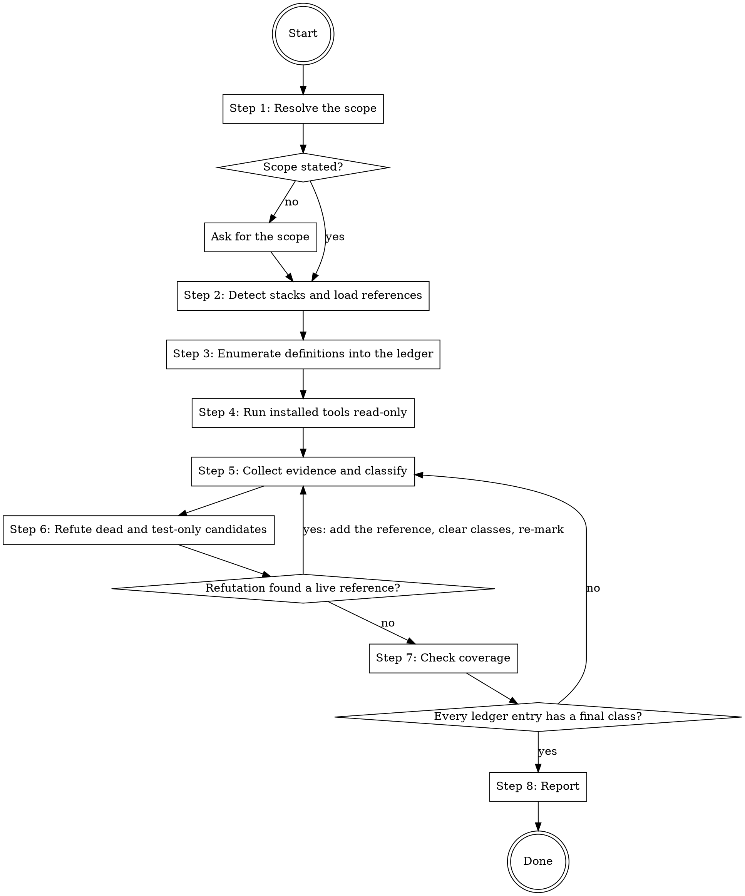

# Sweeping Dead Code

This skill finds unused code in a stated scope and reports it. Never edit, delete, stage, or format a project file. Run only tool commands that are read-only by construction (the tool references' commands) or that the user approved for this sweep (`sweep.tools` commands, Step 4). Write the ledger in the system temporary directory, outside the repository. Code orphaned by an edit in progress belongs to `writing-code`; this sweep is the retrospective pass.

## Workflow

The workflow below can be extended by content earlier in context. Two shapes are recognized:

1. **Pre-Step / Post-Step instructions.** Before executing Step N, check whether earlier context contains a section headed `## Pre-Step-N`. If it does, execute its content as additional instructions, then continue with Step N. After Step N, do the same check for `## Post-Step-N`.
2. **Named-value assignments.** The skill body cites certain configuration values by backticked name alongside an inline default (for example `` `sweep.exclude` ``). When such a name appears, check whether earlier context assigns a value to it. If yes, use the assigned value; otherwise use the inline default.

Both checks default to no-op. When earlier context contains no matching section or assignment, the skill runs entirely on the defaults documented inline. Extension content may cite project files by path; read a cited file when the step that cites it runs, not before.

### Step 1: Resolve the scope

Take one of three scopes from the request:

- **Path**: one or more directories or files.
- **Repository**: every tracked source file, minus `sweep.exclude`.
- **Branch**: the changes since the merge base, `git diff <base>...HEAD` (base default `main`). The ledger holds every definition that encloses an added or changed line of that diff — the nearest Step 3 pattern match above that line in the same file whose body extends past the line (to the matching closing brace, the end of the indented block in Python, or the closing `}` of a shell function); when the extent is unclear, include the definition, since an extra row only costs a search — plus every definition elsewhere in the repository whose name appears on a removed line (lines starting with `-`) of that diff.

When the request names no scope, ask which one; never default silently.

Never enumerate a path in `sweep.exclude`; default if not otherwise stated: dependency and build directories (`vendor/`, `node_modules/`, `.venv/`, `venv/`, `dist/`, `build/`, `target/`) and files whose header marks them as generated.

### Step 2: Detect stacks and load references

Detect the stacks in scope from file extensions and manifests. `project.stacks` overrides detection; default if not otherwise stated: detect from files and project signals.

For each stack (`bash`, `go`, `php`, `python`, `typescript`), load `references/tools/<stack>.md` and `references/stacks/<stack>/indirect-references.md`. For each detected test framework, load `references/stacks/<stack>/<framework>-referenced-by-name.md`:

| Stack | Referenced-by-name files |
|---|---|
| `go` | `stdlib-testing`, `testify`, `ginkgo-gomega` |
| `php` | `phpunit`, `pest` |
| `python` | `pytest`, `unittest` |
| `typescript` | `jest`, `vitest`, `mocha`, `node-test` |

Sweep a stack or framework without a file with the plain-name search only, and name the forms left unchecked in the report.

### Step 3: Enumerate definitions into the ledger

Enumerate every definition in scope by running the search commands from the stack's `## Definition patterns` section — never by reading files and listing what looks unused.

Write the ledger as JSON Lines to `${TMPDIR:-/tmp}/sweeping-dead-code-<timestamp>.jsonl`, one object per definition:

| Field | Value |
|---|---|
| `id` | sequential integer from 1 |
| `stack` | the stack |
| `kind` | `file`, `type`, `function`, `method`, `constant`, `variable`, `member` (enum cases, namespace members, and properties), or `dependency` (a declared package dependency) |
| `name`, `file`, `line` | the definition |
| `class` | null |
| `references` | empty list |
| `evidence` | empty list of strings |

Module-based stacks (TypeScript, Python, PHP) also get one `file` row per source file. State the ledger path in the conversation.

### Step 4: Run installed tools read-only

Run each tool listed in the stack's tool reference only when the project already has it (a lockfile or manifest entry, `vendor/bin/`, `node_modules/.bin/`, or the PATH); never install one. Invoke it from where it was found: `node_modules/.bin/<tool>`, `vendor/bin/<tool>`, or the bare name on the PATH, replacing the tool name at the start of the reference command.

`sweep.tools` replaces or adds tool commands per stack; default if not otherwise stated: the commands in the tool reference. Reject a `sweep.tools` command that contains a flag the tool reference lists under "Never pass", or any of `>`, `|`, `;`, `&`, a backtick, or `$(`, and say so in the report. Before the first run of each remaining `sweep.tools` command in this sweep, show the exact command to the user and run it only after the user approves it in the conversation; skip a declined command and report it.

Before each run:

- Use the exact command from the tool reference or `sweep.tools`, and never pass a flag the reference lists under "Never pass".
- Read the project's configuration for that tool. When it sets a write mode the reference names (for example ruff `fix-only`, PHPStan `errorFormat: removeDeadCode`), use the reference's isolated form of the command or skip the tool and say why.
- Record the write-guard fingerprint: `{ git status --porcelain=v1 --untracked-files=all; git diff HEAD --binary; git ls-files -o --exclude-standard -z | xargs -0 shasum; } | shasum`.

After each run, record the fingerprint again. When the two differ, stop the sweep: report the tool, the command, and the paths that changed, and run no further tool. Restore nothing; the user decides. The guard does not cover git-ignored files, where tool caches live.

Read findings from the tool's parsed output, never from its exit code; several tools exit 0 with findings or non-zero for unrelated messages. Treat a tool finding as evidence for a ledger row, never as a verdict. Add a row for a finding with no matching row.

### Step 5: Collect evidence and classify

For every row without a final class, search the scope and the whole repository for:

- the plain name, excluding the definition itself;
- every form in the stack's indirect-references file;
- non-code files: configuration, manifests, templates, CI workflows, documentation that a tool consumes.

Record each reference in the row's `references` list as `{file, line, side, from}`. `side` is `production` or `test`; the framework's referenced-by-name file lists the test-side forms. `from` is the `id` of the innermost ledger row whose definition encloses the reference — for top-level code in a module-based stack, that file's `file` row — or `root` when no ledger row encloses it (configuration, templates, CI, top-level code of an executable script, files outside the scope).

Mark first, then classify.

**Roots.** A row is `published` when it is a library's public API, an entry file (a `package.json` `main`, `bin`, or `exports` target, a Python `__main__` module or `[project.scripts]` target, a PHP front controller), an entry point the framework calls by convention, a route, a command, a documented CLI flag, or a name in `sweep.entry_points` (default if not otherwise stated: none). Published rows are roots, and so is every row with a production reference whose `from` is `root`.

**Reachability.** A row is reachable when a root reaches it through production references (`from` pointing at a reachable row). Rows that reference only each other and no root are unreachable.

**Uncertain seeds.** A dynamic form from the indirect-references file (a computed `getattr`, a string-built call, a dynamic import) anywhere in production code — inside a reachable row, an unreachable row, or `root` code — makes every unreachable row it could reach an uncertain seed. Narrow the reach as far as the static facts allow: the receiver's type for an attribute lookup, the module or directory of an import base, the literal prefix or suffix of a built name. With nothing to narrow it, the reach is every unreachable row of the kind the form can reach (methods and attributes, functions, files) in the scope. Every unreachable row reachable from an uncertain seed through production references is uncertain too, naming the seed.

Then assign one class per row:

| Class | Rule |
|---|---|
| `published` | The row is a published surface (see Roots). |
| `live` | Reachable from a root through production references. |
| `uncertain` | Not reachable, and an uncertain seed or reachable from one. The row names the dynamic form with its `file:line`, and the seed when it is not the row itself. |
| `test-only` | Not reachable, not uncertain, and at least one test reference. |
| `dead` | Not reachable, not uncertain, and no test reference. |

### Step 6: Refute dead and test-only candidates

Send every `dead` and `test-only` row to an independent refutation before it can be reported. Spawn one fresh subagent per batch of `sweep.refutation_batch_size` rows (default if not otherwise stated: 10) with the prompt from `references/refutation-prompt.md`, filled in with the rows, the stack's indirect-references file content, and the framework's referenced-by-name file content. Do not pass the evidence collected in Step 5. When the host cannot spawn subagents, run the refutation in the session and mark every row refuted in the session "refutation not independent" in the report.

For a row the refutation shows reachable, add the reference to its `references`, set its `class` to null, and set every other row's `class` to null too, because one new reference can make other rows reachable; then return to Step 5, which re-marks reachability from the roots. Rows already refuted keep their refutation result and are not sent to refutation again unless their class changes. A row that survives keeps its class and records "refutation: none found" in `evidence`.

### Step 7: Check coverage

Count ledger rows and rows with a final class. Every row needs a class, and every `dead` and `test-only` row needs a refutation result. Return to Step 5 on any gap.

### Step 8: Report

Report in the conversation, in this order:

1. Scope, stacks, tools run (with the exact commands) and tools skipped or declined (with the reason), ledger path, both coverage counts with the note that coverage counts the definitions the Step 3 patterns and the tools found — a definition form no pattern matches is not in the ledger — and the note that the write guard does not cover git-ignored files.
2. `dead` rows: `file:line — kind name — searches that came back empty — tool that flagged it, if any — refutation result`.
3. `test-only` rows, same columns plus the test files that reference them.
4. `uncertain` rows with the dynamic form that blocks a verdict.
5. `published` rows, one line each.
6. Forms left unchecked (stacks or frameworks without reference files).

Count `live` rows; do not list them. Propose no edits, and stop after the report.
