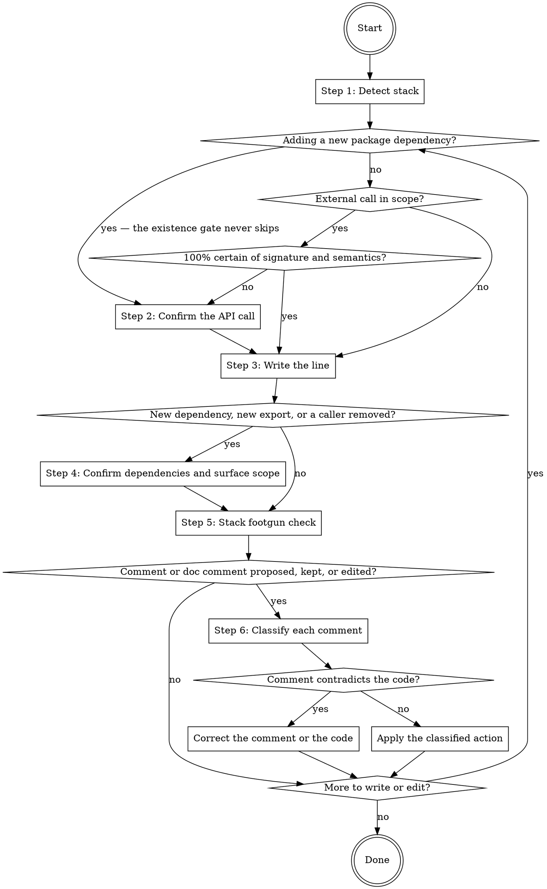

# Writing Code

This skill prescribes what good implementation code looks like. It is a guide for improving code, not a description of what the code currently does. Where existing code diverges from a rule below, the rule wins — fix the code, do not copy the divergence.

## Workflow

The workflow below can be extended by content earlier in context. Two shapes are recognized:

1. **Pre-Step / Post-Step instructions.** Before executing Step N, check whether earlier context contains a section headed `## Pre-Step-N`. If it does, execute its content as additional instructions, then continue with Step N. After Step N, do the same check for `## Post-Step-N`.
2. **Named-value assignments.** The skill body cites certain configuration values by backticked name alongside an inline default (for example `` `code.di_pattern` ``). When such a name appears, check whether earlier context assigns a value to it. If yes, use the assigned value; otherwise use the inline default.

Both checks default to no-op. When earlier context contains no matching section or assignment, the skill runs entirely on the defaults documented inline. Extension content may cite project files by path; read a cited file when the step that cites it runs, not before.

### Step 1: Detect stack

Detect the stack from the file(s) being edited: file extension plus project signals such as `go.mod`, `pyproject.toml`, `tsconfig.json`, or `composer.json`. `project.stacks` overrides detection; default if not otherwise stated: detect from the files and project signals.

A shell file is the `bash` stack on the file alone, ahead of every project signal: extension `.sh`, `.bash`, or `.bats`, or an extensionless file whose shebang names `sh` or `bash`. Shell scripts carry no manifest of their own and routinely sit inside a project of another stack, so a project signal must never route them to that stack.

Load `references/stacks/<stack>.md` for the detected stack (`bash`, `go`, `python`, `typescript`, `php`) — only the matching one. For a stack without a reference file, apply the universal rules plus any project content earlier in context.

### Step 2: Confirm the API call

Before writing or editing a call to any non-builtin symbol, ask: am I 100% certain of this symbol's signature, error and async behavior, and edge-case semantics, or am I pattern-matching from training? If not certain, consult the stack's doc tool with the narrowest query that answers the question — the query-shape table lives in the stack reference.

Skip consultation when the call mechanically repeats an idiom already established in the same file, or when the call already compiles or runs with a passing test exercising it.

**New-dependency gate.** Before adding any new package or module dependency, verify the package exists and the name is exact — against the lockfile, the package registry, or vendored sources. Plausible-but-nonexistent package names are a documented failure mode of generated code, and a near-miss name is a supply-chain risk (slopsquatting). Never add a dependency from memory alone: signature certainty skips consultation for existing symbols, never this existence check.

**In-repo primitives.** When the call touches a domain the project wraps — the rows come from `code.primitives`; default if not otherwise stated: none registered — consult the wrapper before reaching for the raw primitive. The doc tool confirms the call works the way you remember; the primitives lookup confirms it is the right call to make at all. Load `references/primitives.md` for the table shape, the decision test, and the missing-wrapper rule.

### Step 3: Write the line

Before writing logic, search for an existing helper that does it and call it. Write the call or edit the line.

**No silent fallback.** Refuse an unrecognized or invalid input with a message before any fallback runs: a parse failure on a user-supplied file, an argument type no branch handles, an empty value where one is required. Logging and then falling back is allowed only where the fallback is the documented behavior. A documented default for an absent optional value is not such a fallback.

**Validate before the first side effect.** In entry points and functions with side effects, validate every argument before the first bootstrap, write, spawn, or network call. For streaming or incremental input, validate each unit before acting on it.

**Single definition.** Do not add a second copy of a function or a third copy of a block of 3+ lines; copies a project keeps in sync deliberately (generated, or synced by a manifest) are exempt. Parametrize bodies that differ only by a literal. In the lines the edit touches, delete dead guards, dead assignments, and wrappers that only forward to another function, except a wrapper registered as a primitive (Step 2) and a symbol on a published surface (Step 4); the orphaned-symbol rule in Step 4 covers the symbols those deletions leave unreferenced.

### Step 4: Confirm dependencies and surface scope

Skip this step when the edit is a single statement inside an existing function that introduces neither a new dependency nor a new exported symbol and removes no call or reference.

**Dependency entry shape.** When the line introduces a new dependency — a callable, an external service, configuration, a time source, a randomness source, an output stream — it enters via parameter, option, or constructor field (the Explicit Dependencies principle); wiring concrete implementations together happens at the composition root, not deep in the call tree. Reach-for forms — module-level singletons, free environment reads, inline clock or stdout references — hide test seams and bind shared code to one environment. `code.di_pattern` names the project's concrete pattern; default if not otherwise stated: parameter or constructor injection.

**Caller scope.** Every new exported/public symbol needs at least one non-test caller within the same coordinated unit of work — the smallest closed change that ships together. A symbol whose only callers are tests is Speculative Generality: delete it, keep it module-local, or hold the export until the caller is part of the same coordinated change (YAGNI — holding is acceptable, speculative exports are not). Hyrum's Law makes every export a permanent implicit contract, so an export is a liability the moment it ships. `code.export_conventions` adds project rules such as a package-index re-export surface; default if not otherwise stated: none.

**Orphaned symbols.** Caller scope runs in reverse when the edit removes a call, replaces an implementation, or changes a signature. Every symbol that lost a reference — the replaced function, its helpers, imports, parameters, types, constants, configuration keys, files — keeps at least one non-test reference, or it is deleted in this edit together with the tests whose only subject it was; deleting such a test stays in this skill, while editing a surviving test belongs to `writing-tests`. Search the plain name, the forms listed in `references/stacks/<stack>-indirect-references.md`, and non-code files (configuration, manifests, templates, CI). Repeat the search for whatever a deletion orphans until a pass deletes nothing. A replaced implementation is deleted in the same change; keep it only when the user asked for it. A symbol on a published surface — a library's public API, a documented CLI flag or route — is reported to the user, not deleted. `code.dead_code_check` names a project command that reports unused code; default if not otherwise stated: none. When it is set, run it after the search and handle its findings in the edited scope the same way.

### Step 5: Stack footgun check

Scan the line just written against the stack's footgun catalog in the stack reference. This check is prescriptive: apply it even when nearby code does not. `code.footgun_additions` appends project-specific entries to the catalog; default if not otherwise stated: none.

### Step 6: Classify each comment

Comments split into two tiers, and visibility decides which one applies rather than the syntax used: structured docs on an exported or protected declaration are a contract, the same tags on a private declaration are an implementation comment.

**API/doc comments** are the interface contract — the abstraction is what the doc comment says it is. Follow the stack's convention; the form and a minimal-correct example live in the stack reference. Compress a doc comment that purely paraphrases the signature to one identifier-prefixed line. Never delete doc comments where project lint requires them; `code.comment_enforcement` names such rules; default if not otherwise stated: none.

**Implementation comments** default to none. Write or keep one only when it carries point-of-use *why* — a hidden constraint, subtle invariant, bug workaround, or deliberate tradeoff the reader cannot infer from the code and types. When deleting code, delete its why-comment too; an orphaned why is dead weight.

Check each comment against the code first: a comment that contradicts what the code does is corrected, never left standing and never deleted to resolve the mismatch. Then load `references/comments.md`, classify the comment against its table, and apply the bucket's action. The reference also carries the load-bearing-why worked shape, the negative-invariant shape, the regex exception, marker discipline, and the banned patterns.

Skip any comment carrying a marker in `comments.exemption_markers`; default if not otherwise stated: none. Always keep a comment matching `comments.preserve_patterns`; default if not otherwise stated: none. Hold every `TODO`/`FIXME` written or touched to `todo.ticket_format`; default if not otherwise stated: an owner plus a tracking reference. Never swap a term listed in `domain.terms` for a near-synonym while rewriting a comment; default if not otherwise stated: none registered. When `docs.surfaces` is assigned, a comment restating what a listed surface owns is cut to its local why plus a stable identifier instead of duplicating the surface; default if not otherwise stated: comments are judged on their own merits.
