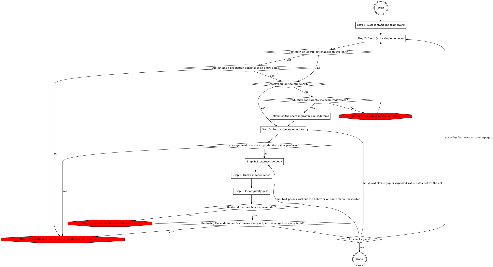

# Writing Tests

Where an existing test diverges from a rule below, the rule wins — fix the test, do not copy the divergence.

## Workflow

The workflow below can be extended by content earlier in context. Two shapes are recognized:

1. **Pre-Step / Post-Step instructions.** Before executing Step N, check whether earlier context contains a section headed `## Pre-Step-N`. If it does, execute its content as additional instructions, then continue with Step N. After Step N, do the same check for `## Post-Step-N`.
2. **Named-value assignments.** The skill body cites certain configuration values by backticked name alongside an inline default (for example `` `tests.parallelism` ``). When such a name appears, check whether earlier context assigns a value to it. If yes, use the assigned value; otherwise use the inline default.

Both checks default to no-op. When earlier context contains no matching section or assignment, the skill runs entirely on the defaults documented inline. Extension content may cite project files by path; read a cited file when the step that cites it runs, not before.

### Step 1: Detect stack and framework

Detect the stack from the file(s) being edited: file extension plus project signals such as `go.mod`, `pyproject.toml`, `tsconfig.json`, or `composer.json`. `project.stacks` overrides detection; default if not otherwise stated: detect from the files and project signals.

Then detect the **test framework** within that stack. Read the dependency manifest and the test configuration, and confirm against an existing test file's imports; the framework a project declares is authoritative over the one its file extensions suggest. `tests.frameworks` names the project's frameworks and runners; default if not otherwise stated: detect as described. When a project runs more than one framework (a unit runner plus an end-to-end runner, or a legacy suite alongside a current one), select per file being edited.

Load the matching reference — `references/stacks/<stack>/<framework>.md`:

| Stack | Framework references |
|---|---|
| `go` | `stdlib-testing.md`, `testify.md`, `ginkgo-gomega.md` |
| `python` | `pytest.md`, `unittest.md` |
| `typescript` | `vitest.md`, `jest.md`, `node-test.md`, `mocha.md` |
| `php` | `phpunit.md`, `pest.md` |
| `bash` | `bats.md` |

When the detected framework has no reference file, apply the universal rules plus any project content earlier in context, and do not substitute a sibling framework's file.

### Step 2: Identify the single behavior

Articulate the behavior in one sentence using business language. The test name is a paraphrase of that sentence, not of the implementation. If the sentence contains "and", write two tests. If it names an implementation choice (which dependency was called, internal call order, algorithmic decomposition), there is no test to write.

When the test is new, or its subject changed in the current edit, confirm the subject has a production caller before writing anything: a non-test reference, found by searching the plain name and the forms listed in `references/stacks/<stack>/indirect-references.md` (for a stack without that file, the plain name plus configuration and manifest files, and the report names the forms left unchecked), or a declared entry point — a published package's public API, a route, a command, a handler the framework calls by convention. References from test files do not count; `references/stacks/<stack>/<framework>-referenced-by-name.md` lists the test-side forms that name production code without calling it. When neither exists, write no test: stop and report the subject as a dead-code candidate to the user, or to the workflow that invoked this skill, with the searches that came back empty. This skill never deletes production code: the only production change it leaves in place is a seam introduced in this step, and the Step 6 falsifiability check's temporary removal is restored and verified against the saved `git diff -- <file>` output before the workflow continues.

This skill takes the classicist position: verify state through the public API, use real collaborators unless they are awkward to stand up, and reserve test doubles for genuine boundaries (network, clock, external processes).

When the behavior is real but not observable through the current public API, the workflow branches three ways: introduce a production-code seam so the behavior becomes observable through it — but only when production code wants the injection point regardless of testability; reframe the test at an existing public surface that already exhibits the behavior; or delete the candidate as implementation detail.

Load `references/behavior.md` to classify the candidate against the do-test / don't-test lists, the carve-outs, the four seam patterns, and the single-behavior signs.

### Step 3: Source the arrange data

Choose one source from the acceptable sources in `references/data.md`. A project fixture helper named by `tests.fixture_sources` is also a source; default if not otherwise stated: the universal list only.

`tests.scale_gating` names the project's pattern for production-scale gated tests; default if not otherwise stated: none — do not invent a gated tier.

When the arrange must construct a state no production caller can produce — an argument every caller rules out, a flag no caller sets, an error the dependency never raises — the branch under test is dead, or the test reaches past the public behavior. Do not build the fixture: stop and report the branch to the user, or to the invoking workflow, naming the callers checked. The production-code rule in Step 2 applies.

Load `references/data.md` for the acceptable and flagged sources, the external-tool stub rule, the helper rule, and the scale-gating pairing.

### Step 4: Structure the body

Pick the shape: an arrange/act/assert body, or a table-driven / parametrized case (the table construct the framework reference names).

Assertion scope: multiple assertions are acceptable only when they verify one logical behavior — unrelated claims in one body are Assertion Roulette. Assertion strength: assert the behavior, not volatile exact counts or generated-output snapshots; exact values that are part of a specification stay exact.

Load `references/shape.md` for the AAA rule, the conditional-logic carve-outs, the one-outcome rule, refusal assertions, and the CLI-output rules.

### Step 5: Guard independence

Ask: would randomized order, running a single test alone, or parallel execution change the outcome? If yes, the test depends on state outside its body.

`tests.parallelism` states the project's parallel-execution facts; default if not otherwise stated: none stated — guard independence as if tests could run in any order and concurrently.

Load `references/independence.md` for the leak vectors, the scoped-restore rule, the non-determinism rule, and the hermetic rule.

### Step 6: Final quality gate

Run four checks after the body is drafted:

**Redundancy.** Every case (table row, parametrized case) and every top-level test covers a unique code path, boundary value, or regression. Key on why the case exists, not on what the input looks like. Before consolidating a case, run the preservation check against the indicator table in `references/behavior.md`; a case with any listed indicator stays. When a case or test is deleted, delete the data provider, fixture, or helper only it referenced; `references/stacks/<stack>/<framework>-referenced-by-name.md` lists the forms that reference test code by name.

**Guard-clause isolation.** When the test targets one early-return in a function with multiple sequential guards, run the guard-clause procedure in `references/behavior.md`.

**Falsifiability.** The test fails when the behavior is removed: save the output of `git diff -- <file>` for the production file, delete the guard or revert the line under test, run the test, expect a failure, restore the code, and confirm that `git diff -- <file>` matches the saved output before continuing; when it does not, stop and report the failed restore to the user, or to the invoking workflow, naming the file. The expected value does not already hold before the act. Every claim in the test name is asserted.

When removing the code under test leaves every observable output unchanged on every input the code can receive — not only the inputs the suite feeds it — write no test: stop and report the code as a redundant-code candidate to the user, or to the workflow that invoked this skill, naming the code path that already produces the same output. The production-code rule in Step 2 applies.

**Coverage.** Every guard, refusal, option, default, and blocking rule the edit adds or changes has a case that triggers it. A test list that mirrors a production registry is enumerated from that registry at run time, never written as a literal list in the test; asserting that two registries stay in sync is the drift-guard registry-parity carve-out in `references/behavior.md`.

The preservation table and the guard-clause procedure live in `references/behavior.md`. On a redundancy failure return to Step 2 (the case may be reframable to a unique branch); on a coverage gap return to Step 2 for each untriggered rule; on a guard-clause failure, or an expected value that holds before the act, return to Step 3 (the arrange needs more or different setup); on a test that passes without the behavior or a name claim left unasserted, return to Step 4.
