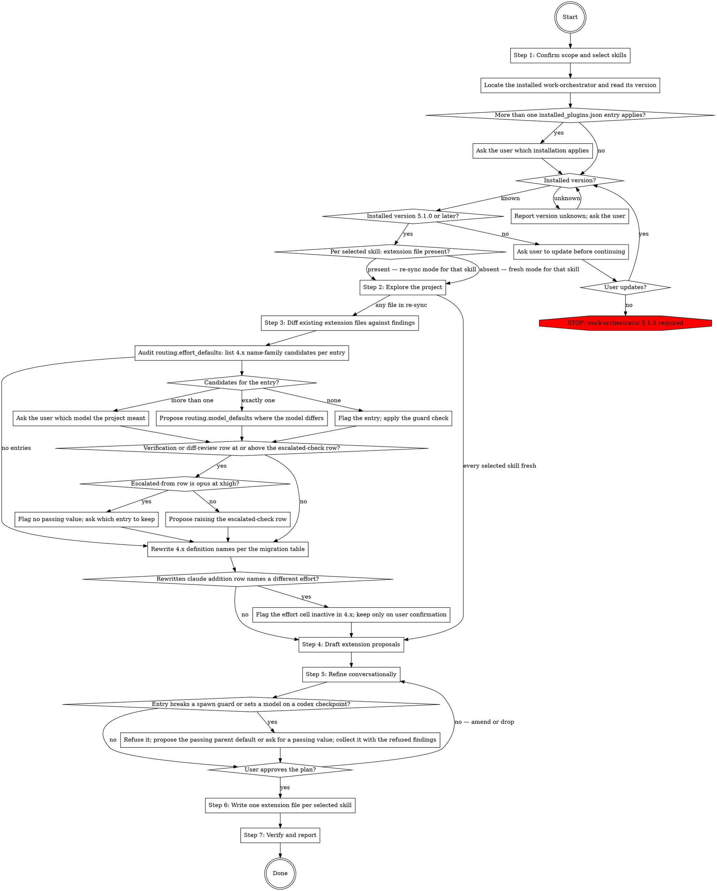

# Setting Up the work-orchestrator Extensions

Create the extension files for the `work-orchestrator` plugin's skills in the current project — `orchestrating-subagent-work` (gates, fences, rules, routing) and `orchestrating-session-work` (session topology, session deviation triggers), one file per skill under `.claude/extensions/work-orchestrator/`. The `work-orchestrator` plugin delivers the files itself, so no delivery configuration is written. Re-sync mode audits existing files against the current project and turns stale claims into update proposals.

## Workflow



### Step 1: Confirm scope and select skills

Confirm the current working directory is the project root that should receive the extensions. If unclear, ask the user before doing anything else.

Ask which skills the project extends: `orchestrating-subagent-work`, `orchestrating-session-work`, or both. Default to `orchestrating-subagent-work` alone when the user has no session-distribution workflow; propose the session skill only when the user distributes work across named sessions.

Per selected skill, run in **re-sync mode** when its file under `.claude/extensions/work-orchestrator/` exists; otherwise run in **fresh mode**. The two files are independent — one may re-sync while the other is created fresh.

This skill targets Claude Code. `work-orchestrator` ships no Codex manifest, so there is no host branch and no `AGENTS.override.md` to provision.

Locate the installed `work-orchestrator` before exploring, in both modes: read `~/.claude/plugins/installed_plugins.json`, take the `work-orchestrator@<marketplace>` entry that applies to this project (a project-scoped entry before a user-scoped one; ask when more than one could apply), and read its `installPath` and `version`. `<installPath>/EXTENSION.md` is the contract Step 4 reads.

- **Version unknown** (no entry, no readable version): report the version as unknown and ask the user which `work-orchestrator` version is installed. Write no 5.x content until the user resolves it, and do not assume 4.x.
- **Below 5.1.0:** ask the user to update `work-orchestrator` to 5.1.0 or later before continuing; re-check the installed version after the update. If the user declines, write nothing and report that work-orchestrator 5.1.0 or later is required.
- **5.1.0 or later:** continue with every step.

### Step 2: Explore the project

Dispatch read-only exploration — Explore subagents for breadth, direct reads for confirmation — with the probe checklists below. Every proposed row must carry evidence: the file and line the claim traces to. Never propose a gate command, a protected path, or a banned command class from memory or plausibility; a wrong gate command sends every implementer worker after a command that fails.

Probe checklists:

- **Gates:** build, format, typecheck, lint, and test commands as actually declared — Makefile targets, `package.json` scripts, `taskfile.yml`, `justfile`, `composer.json` scripts, tox/nox config, and the CI workflow files. The CI workflow is the strongest evidence of what the project considers a gate. For each, note whether it needs network, containers, a database, or a device.
- **Fence:** generated output directories and codegen markers, lockfiles, vendored trees, migration history, `.gitattributes` `linguist-generated` entries, and anything a `.gitignore` or build step rewrites. Separately: command classes that touch shared infrastructure, cost money, or need a device — e2e configs, `docker-compose` files, deploy scripts, seed or reset commands.
- **Conduct rules:** rule files and contributor guidance that state conduct a worker must follow beyond the universal three (fail-hard, calibrated honesty, doc drift) — `CLAUDE.md`, `AGENTS.md`, `.claude/rules/`, `CONTRIBUTING.md`.
- **Skill files:** project skills the project expects to govern implementation or review, and which scopes warrant each.
- **Review lenses:** recurring defect classes visible in git history and issue labels; directories with a security or privacy flavor that the universal table routes to `gpt-6.1-terra` rather than `gpt-6.1-sol`.
- **Checkpoint types and deviation triggers:** recurring work types the routing table has no profile for (schema migrations, generated clients, translation catalogs), and project failure modes the universal trigger list does not name.
- **Session topology** (only when `orchestrating-session-work` is selected): the roles the project distributes work across, per-role duties, who messages whom, and write ownership — which role owns which working tree or branch, and which roles work read-only against a clone or pinned worktree. This checklist is conversational rather than probed: roles and duties come from the user; exploration contributes only the working-tree and branch facts (worktrees in use, long-lived branches, formatter or build steps that rewrite files).
- **Handoff referent guard** (only when `orchestrating-session-work` is selected): whether receiving sessions read authoritative persistent artifacts end to end — spec files, a branch memory, a standing plan document. When they do, propose the parent plugin's `Post-Compose` referent-guard example (`EXTENSION.md` §Example: Guarding Handoff Referents at Compose) for the session-work file, and a citation-discipline `project.conduct_rules` entry for the subagent-work file when that skill is also selected. Evidence is the artifact files themselves; name them in the proposal.

### Step 3: Diff existing extension files against findings

Re-sync mode only; fresh mode proceeds directly to Step 4.

Diff each claim in every existing extension file against the current findings: gate commands that no longer exist or changed invocation, protected paths that moved or were deleted, cited files that no longer exist or no longer cover what the citation claims, routing additions for checkpoint types the project no longer runs, routing additions or other content naming a retired 4.x agent definition (see the migration table below), conduct rules whose source file was rewritten, and topology rows naming working trees or branches the project no longer uses. Turn every stale claim into an update proposal with its evidence. On an unchanged project, propose only what the audits of existing entries in this step and Step 5 flag.

Report the gate table as the highest-value diff: a stale gate command is the one drift that silently breaks every implementer dispatch.

Run the `routing.effort_defaults` audit below first, then the 4.x name rewrite. With no `routing.effort_defaults` entry, go straight to the rewrite.

Rewrite every retired 4.x agent definition name found in an extension file to the 5.x duty definition plus model and effort from this table, and propose the rewrite like any other stale claim. In a routing-additions row, the actor cell becomes `` `<definition>` on <model> `` (spawned as `work-orchestrator:<definition>`) and the effort cell takes the table's effort, the level the 4.x definition ran at; for the haiku definitions, which inherited the session level, `low` replaces it. Where a claude addition row already names a different effort, flag that cell as inactive in 4.x, where the definition's own effort applied, and ask the user whether to keep it before carrying it over.

| 4.x definition | 5.x definition | Model | Effort |
|---|---|---|---|
| `search-haiku` | `search` | haiku | low |
| `investigate-haiku` | `extract` | haiku | low |
| `gate-run-haiku` | `gate-run` | haiku | low |
| `investigate-sonnet-low` | `lookup` | sonnet | low |
| `investigate-sonnet-medium` | `source-read` | sonnet | medium |
| `investigate-sonnet-high` | `adversarial-check` | sonnet | high |
| `investigate-opus-medium` | `escalated-check` | opus | medium |
| `investigate-opus-high` | `root-cause` | opus | high |
| `investigate-opus-xhigh` | `source-conflict` | opus | xhigh |
| `design-opus-xhigh` | `design` | opus | xhigh |
| `implement-sonnet-medium` | `implement` | sonnet | medium |
| `implement-sonnet-high` | `implement` | sonnet | high |
| `implement-opus-medium` | `implement` | opus | medium |
| `implement-opus-high` | `implement` | opus | high |
| `implement-opus-xhigh` | `implement` | opus | xhigh |

Audit every `routing.effort_defaults` entry on a claude checkpoint against its 4.x meaning. In 4.x such an entry selected the agent definition carrying that effort, which could change the model; in 5.x it sets the effort only. Find the row's 4.x definition in the table below; its name prefix (`search`, `investigate`, `implement`, `design`, or `gate-run`) is the row's 4.x name family. List the definitions of that family in the migration table above that carried the entry's effort; `search-haiku`, `investigate-haiku`, and `gate-run-haiku` carried no effort. For example `Verification of review findings = xhigh` has one candidate, `investigate-opus-xhigh`, on opus.

- Exactly one candidate: where its model differs from the row's 5.x model, propose a `routing.model_defaults` entry with that model, subject to the spawn guards in Step 5.
- No candidate: flag that 4.x could not honor the entry. If the spawn guards refuse it, handle it as a refused entry in Step 5; otherwise flag that it now takes effect and ask whether to keep it.
- More than one candidate: do not pick; ask the user which model the project meant.
- When a proposal leaves the "Verification of review findings" or "Diff review of a codex-written fix batch" row at or above the "Verification a cheaper pass returned thin or unconvincing on" row (the `escalated-check` row), also propose raising that row so the escalation guard passes: the same model as the escalated-from row at the next effort up, or, when that row is at xhigh, the next stronger model at medium. When the escalated-from row is opus at xhigh, no passing value exists: flag it and ask the user which entry to keep.

| Shipped routing row | 4.x definition | 5.x definition, model, effort |
|---|---|---|
| One-to-two-fix follow-up | `implement-sonnet-medium` | `implement`, sonnet, medium |
| Substantial coding batch whose items are self-contained (decided designs, no cross-item interaction) | `implement-opus-medium` | `implement`, opus, medium |
| Fix batch whose items interact across files | `implement-sonnet-high`, or `implement-opus-high` for dense code | `implement`, sonnet or opus, high on sonnet and medium on opus |
| Coding batch reworking a mechanism or spanning packages | `implement-opus-xhigh` | `implement`, opus, medium |
| Verification of review findings | `investigate-sonnet-high` | `adversarial-check`, sonnet, high |
| Verification a cheaper pass returned thin or unconvincing on | `investigate-opus-medium` | `escalated-check`, opus, medium |
| Diff review of a codex-written fix batch | `investigate-sonnet-high` | `adversarial-check`, sonnet, high |
| Gate re-run outside worker sandboxes after an implementer checkpoint | `gate-run-haiku` | `gate-run`, haiku, low |
| Deep read of one source (installed package, spec, vendor doc) | `investigate-sonnet-medium` | `source-read`, sonnet, medium |
| One closed question with a stated place to look | `investigate-sonnet-low` | `lookup`, sonnet, low |
| Locating code, symbols, or instances of a convention | `search-haiku` | `search`, haiku, low |
| Mechanical enumeration, extraction, catalog/convention sweeps, dispatch-prep | `investigate-haiku` | `extract`, haiku, low |
| Mechanism behind an observed behavior the session cannot pin down | `investigate-opus-high` | `root-cause`, opus, high |
| Two sources disagreeing on something a checkpoint turns on | `investigate-opus-xhigh` | `source-conflict`, opus, xhigh |
| Open-ended design, architecture, root-cause judgment (dispatched `design` only) | `design-opus-xhigh` | `design`, opus, xhigh |

### Step 4: Draft extension proposals

Map every finding onto the parent skills' formal mechanisms only, into the file of the skill it belongs to:

1. **Named-value assignments** — the names in `<installPath>/EXTENSION.md` (located in Step 1) under the target skill's §Recognized Named Values. Each has a default and a documented effect. Session topology maps to `sessions.topology`; session failure modes map to `sessions.additional_triggers`.
2. **Workflow position extensions** — `## Pre-<position>` / `## Post-<position>` sections of imperative instructions, where the position is one of `Preflight`, `Strategy`, `Dispatch`, `Adapt`, `Report` for `orchestrating-subagent-work`, and one of `Strategy`, `Compose`, `Dispatch`, `Adapt`, `Report` for `orchestrating-session-work`.

If a finding cannot be mapped to either mechanism, surface it to the user and ask whether to drop or rephrase it. Do not write content that lies outside the two mechanisms.

**Append-only guard.** Every list-shaped value adds to its universal list and never shortens it. A finding that amounts to "this project does not need one of the universal banned command classes" or "these conduct rules do not apply here" is not expressible and must not be dressed up as an assignment. Surface it to the user as a disagreement with the plugin, not as a proposal.

**Fence guard.** The consent gate, the deviation checks, the halt state, the verification shape, dual-confirmation closure, session enumeration, and the three mandatory message blocks are outside the contract. A finding that would soften any of them — a project that "always runs codex-less", a checkpoint that "does not need a second confirmer", a fast path that skips the outside-sandbox gate re-run, a dispatch message that "does not need the SKILL block", a topology that shares one working tree between two writing roles — is refused, not encoded. Collect these with the improvement candidates below.

Do not author `routing.codex_bias = codex-less`. Treat a persistent from-file value as the refused "always runs codex-less" shape and as unable to serve as consent. Explain that codex-less is a per-session consent decision that the user must state directly, and record it among the surfaced decisions rather than in the file.

**Loop-node guard.** `Dispatch` and `Adapt` fire on every pass in both skills, and `Compose` fires on every dispatch item in `orchestrating-session-work`. Content proposed for any of them must be safe to repeat; a proposal that assumes it runs once per task belongs at `Strategy` or `Report`.

**Prescriptive guard.** Extension content is project *infrastructure and conventions*: gates, fences, rules, lenses, checkpoint types. Never weaken an orchestration discipline of the parent skill to match how the project currently dispatches work. Collect observed shortcuts into an "improvement candidates" report for the user instead of encoding them.

**Reference-like entries.** When a finding's content already lives in a project file, or outgrows a few inline lines, propose a citation instead of inlining it — and state where it travels. In an `orchestrating-subagent-work` extension, a cited path passes to a worker as required reading in the SKILLS block, not into the session; in an `orchestrating-session-work` extension, it travels inside the dispatch message's task body as an explicit file reference the sibling session reads itself. A gate table stays inline; a full security-review checklist becomes a cited file.

### Step 5: Refine conversationally

Work one family at a time, in the order gates → fence → rules and lenses → routing → topology → handoff referent guard (the last two only when `orchestrating-session-work` is selected). For each, present the findings with their evidence and the proposed content, then ask targeted questions via AskUserQuestion:

- Confirm each gate's exact command, and whether it runs inside a `workspace-write` sandbox. For a gate that does not, get its one permitted fallback and whether an independent worker re-runs it outside.
- Accept or reject each protected path and each banned command class, with evidence.
- Confirm which conduct rules and project skill files a worker must receive, and the scope condition for each.
- Accept or reject each proposed routing addition, effort override, and model override — an override needs the project's own evidence, not a preference. An effort override on a codex checkpoint sets the invocation flag, so any level except `max` is expressible. An effort override on a claude checkpoint sets the spawn's effort. A model override (`routing.model_defaults`) applies to claude checkpoints only and names haiku, sonnet, or opus; refuse one that targets a codex checkpoint, since it has no effect there. Check every claude entry the extension file will hold, including existing entries, entries re-sync maps from a 4.x definition, and new proposals, against the parent's spawn guards, quoted here, using each checkpoint's effective model and effort after both overrides. Do not write an entry the guards refuse; propose the parent row's default where one exists and passes, otherwise ask the user for a value the guards pass, and collect the refused entry with the refused findings.

  > Spawn guards: check every claude spawn before making it, whether it comes from a shipped row, a `routing.additions` row, an escalation, a codex-less substitution, or a nested spawn. Refuse a model of fable, an effort of `max`, and opus at `low`. Refuse `implement` on opus above `medium`, and `implement` on sonnet below `medium`. Refuse haiku on every shipped row except "Gate re-run outside worker sandboxes after an implementer checkpoint"; "Locating code, symbols, or instances of a convention"; and "Mechanical enumeration, extraction, catalog/convention sweeps, dispatch-prep". Haiku on a `routing.additions` row is allowed only where its output reaches a decision through a verification stage or a deterministic check. Run `escalated-check` stronger than the claude row it escalates from: a stronger model, or the same model at a higher effort (haiku < sonnet < opus; low < medium < high < xhigh); after a codex-less review, compare against the row that review ran at. A refused value is not applied: keep the default where the default passes these guards, otherwise do not make the spawn, and report the refusal in the strategy message or the adaptation delta.

  A routing addition's claude actor names one of the duty definitions the parent plugin ships plus a model (haiku, sonnet, or opus); propose a duty none of them covers as an improvement candidate for the parent plugin, not as an assignment. Ask whether the project wants a persistent codex/claude bias; offer `codex-heavy`, `claude-lean`, or none, and record `routing.codex_bias` when selected. Treat this bias as a preference, not a Step 2 probe target, and exempt it from the override evidence requirement.
- Confirm each proposed deviation trigger.
- For the topology: confirm the roles, per-role duties, and message flow with the user (they are the source, not exploration), and confirm write ownership against the explored working-tree facts — every tree has exactly one writing role, and read-only roles get the clone-or-pinned-worktree instruction.
- For the handoff referent guard: confirm the authoritative artifacts by name, and whether the project wants the `Post-Compose` guard, the `project.conduct_rules` entry, or both.

Translate free-form intent into named values or positions before writing. Loop until the user approves each family; on rejection, amend or drop and re-present.

Do not run a gate command to verify it. Confirm it exists in its declaring file, and take sandbox behavior from the user rather than from a trial run.

### Step 6: Write one extension file per selected skill

Write one file per selected skill under `.claude/extensions/work-orchestrator/` — `orchestrating-subagent-work.md`, `orchestrating-session-work.md` — creating the directory if needed. Use this template per file, omitting any section with no entries:

````
## Named-value assignments

- `<name>` = `<value>`

## Pre-<Position>

<imperative instructions>

## Post-<Position>

<imperative instructions>
````

One bullet per assigned name under the single `## Named-value assignments` heading. A value with internal structure — the gate table, a routing-additions table, the topology table — is written as an indented block under its bullet rather than squeezed onto the bullet line. One section per workflow position, ordered as the positions occur in that skill's workflow: `Preflight`, `Strategy`, `Dispatch`, `Adapt`, `Report` for `orchestrating-subagent-work`; `Strategy`, `Compose`, `Dispatch`, `Adapt`, `Report` for `orchestrating-session-work`.

Verify after writing each file: every section is one of the three template sections above, every position name is one of that skill's five, every assigned name belongs to that skill's recognized set, and the sections appear in the order shown.

### Step 7: Verify and report

Confirm in this order, per written file:

1. The extension file exists and matches the Step 6 template.
2. Every assigned name appears in the parent plugin's §Recognized Named Values table for that skill.
3. Every cited file path exists.
4. The file is not ignored by version control. It is project configuration and must be committed. Do not create a commit without the user's explicit approval, but report untracked state as incomplete setup.

Report the files written, the evidence behind each gate row, and the improvement candidates and refused findings collected in Step 4 and Step 5. Confirm delivery by invoking each written skill and checking that a `<project_extension>` block for it appears; if none appears, report that the session needs a restart, and stop. In re-sync mode, when Steps 3 to 5 made no proposal of any kind, report that no changes were proposed.
