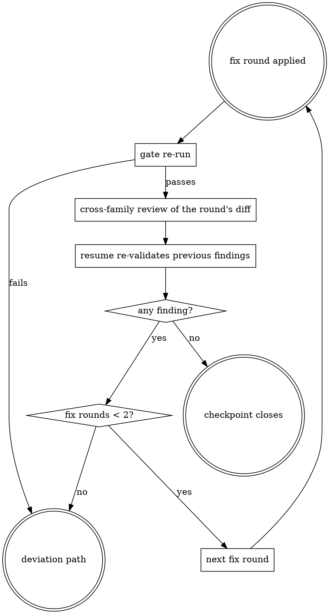

# Codex dispatch

Codex-specific invocation mechanics. The prompt blocks a codex worker receives are worker-shaped, not codex-shaped, and live in `worker-prompts.md`; read that file for what goes into the prompt and this one for how the process is invoked.

## Invocation hygiene

- CLI only: `codex exec` (and `codex exec resume` for re-validation). Never an MCP transport.
- Codex dispatches run sequentially — never two codex processes against the working tree at once. Read-only claude subagents may run in parallel with a background codex run.
- A fresh `codex exec` dispatch passes exactly: `-m <model>`, `-c model_reasoning_effort=<effort>`, `-c approval_policy=never`, `--sandbox read-only` (reviews) or `--sandbox workspace-write` (implementers), `--disable memories` on review dispatches and every other non-implementer dispatch (implementer dispatches omit it, the one exception to the next sentence), `-C <repo root>`, plus whatever `codex.extra_config` assigns — nothing else. Never rely on `~/.codex/config.toml` defaults. An environment that appears to need another flag gets it registered as `codex.extra_config`, or the addition announced as a deviation before dispatch — never added silently at dispatch time. `codex exec resume` closes over a different set, stated in `## Re-validation loop` below.
- `codex.extra_config` supplies additional `-c key=value` flags appended to every invocation; default if not otherwise stated: none — the flags above only. Appends only: reject an assignment that would set `approval_policy`, `sandbox_mode`, `model_reasoning_effort`, the model, or the memories setting (passing or omitting `--disable memories`), since those carry the dispatch's safety and routing contract.
- The prompt is a file piped on stdin.
- Never instruct codex to avoid running shell commands — its file reads are shell commands.

## Re-validation loop



### Fix round applied

Fixes from a review are applied by a worker checkpoint by default (a codex fix batch or a sonnet follow-up), never by the session unless no worker route fits.

### Gate re-run

Re-run the round's gate commands at the "Gate re-run outside worker sandboxes after an implementer checkpoint" row; a failure is a deviation, as that row states.

### Cross-family review of the round's diff

When the fixes were not codex-applied, the resumed codex review thread is this review. When codex applied them, dispatch the "Diff review of a codex-written fix batch" row in addition to the resume. A session-applied fix also needs a sonnet diff review of the session's changes.

### Resume re-validates previous findings

Resume the same codex review session once per fix round instead of dispatching a fresh review. When the review checkpoint merged several codex reviewers' outputs, resume each reviewer's session for its own findings.

```
codex exec resume <session-id> -c approval_policy=never \
  -c sandbox_mode=read-only --disable memories - <<'EOF'
A fix round was applied to the tree. Its diff, each fix's decided design
and test duties, and the fenced file list follow. Re-validate each of your
previous findings against the current tree: fixed / not fixed. Then report
any new finding in the diff.
<when the fixes were not codex-applied:> Also check each fix against its
decided design and test duties, confirm the diff touches only the fenced
files, and confirm no new untracked files appeared.
Same output contract.
<the fix round's diff, taken against the fixed files' state before the round, plus the content of any new file>
<each fix's decided design and test duties>
<the fenced file list>
EOF
```

A resume passes only `--model`, `--config` (`-c`), and `--disable`. `exec resume` rejects `--sandbox` and `-C`, so the sandbox rides `-c sandbox_mode=…`; workdir and model restore from the session, and output arrives on stdout. Capture the printed session id at the original dispatch.

### Any finding?

A previous finding reported not fixed and a new finding, a regression included, are both findings.

### Fix rounds < 2?

Count the fix rounds this checkpoint has run.

### Next fix round

Every open finding goes into the next fix round.

### Deviation path

A finding still open after two fix rounds goes to the deviation path.

### Checkpoint closes

The checkpoint closes when the round's gate re-run and cross-family review pass and the resume reports every previous finding fixed with no new finding.

A codex-less review checkpoint has no resume equivalent: re-validation there is a fresh independent worker against the same scope, and the trust boundaries in `worker-prompts.md` apply unchanged.
